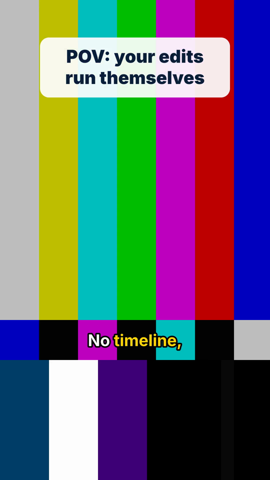

# video-editing-skills

Agent skills that let Claude Code or Codex edit short-form video from the
terminal with ffmpeg: split long recordings, add hook text, caption, fix
audio, make loops/GIFs/stickers, QC the render and publish to YouTube.

Each skill is a `SKILL.md` (when to use it, workflow, rules) plus small,
parameterized scripts that print JSON. The agent reads the JSON and decides
the next step. It does not need to watch the video, and every script works the
same when you run it by hand.



*A real frame from the smoke-test pipeline (synthetic test pattern, hook plate
from `hook-overlay`, word-highlighted caption from `captions`).*

## Why this exists

Most open video-agent skills fall into two groups:

- **Talking-head editors.** They transcribe speech, pick the good takes and cut
  on words. They have little to work with when the footage has no speech.
- **Generic ffmpeg wrappers.** They make any edit possible, but they leave the
  workflow, the guardrails and the QC to you.

This repo covers the content in between: **screen recordings, app captures,
gameplay, music and quiz shorts, loops, GIFs and stickers**. Cut points come
from scene changes and audio pauses, not from a transcript. It also ships the
**production guardrails** needed to post at volume: clips have to open on real
content, QC runs before anyone sees a render, a proof sheet and an explicit
human approval come before anything goes live, and an upload ledger stops a
re-run from posting the same video twice.

The scripts are generalized from tooling I used to cut, brand, QC and upload
hundreds of Shorts.

## Skills

| Skill | Use it for | Scripts |
|---|---|---|
| [`video-editing`](skills/video-editing/SKILL.md) | Router: picks the skill, sets the pipeline order and the hard rules | (none) |
| [`auto-cut`](skills/auto-cut/SKILL.md) | Suggest cuts (scene + pause), frame-accurate split, trim dead lead-in | `suggest-cuts.mjs` `split.mjs` `trim-lead.mjs` |
| [`hook-overlay`](skills/hook-overlay/SKILL.md) | Hook/title plate rendered with sharp, overlaid with ffmpeg (no `drawtext` needed), batch + hook rotation | `render-hook.mjs` |
| [`captions`](skills/captions/SKILL.md) | faster-whisper word timestamps, ASS/SRT with active-word highlight, burn-in, word-safe cut snapping | `transcribe.py` `make-captions.mjs` `burn.mjs` `snap-to-words.mjs` |
| [`audio-polish`](skills/audio-polish/SKILL.md) | Two-pass loudnorm with verification, silence trim with padding, click-free joins and crossfades | `loudnorm.mjs` `trim-silence.mjs` `join.mjs` |
| [`loops-gifs-stickers`](skills/loops-gifs-stickers/SKILL.md) | Seamless loops (crossfade / ping-pong), palettegen GIFs with captions, WebP/GIF/WebM stickers | `loop.mjs` `gif.mjs` `sticker.mjs` |
| [`render-qc`](skills/render-qc/SKILL.md) | ffprobe/ffmpeg checks (size, fps, duration, loudness, true peak, black and frozen frames), proof sheets, approve gate | `verify-render.mjs` `proof-sheet.mjs` `approve.mjs` |
| [`youtube-publish`](skills/youtube-publish/SKILL.md) | PKCE OAuth, private-by-default resumable upload, sha256 ledger, metadata lint, dry run, quota cap | `auth.mjs` `upload.mjs` |

Every Node script supports `--help`, plus `--help --json`, which prints a
machine-readable contract (inputs, outputs, how to verify) so an agent can call
the script correctly without reading its source. `transcribe.py` supports the
same `--help --json`.

## Install

### As a Claude Code plugin

```text
/plugin marketplace add zaddy99999/video-editing-skills
/plugin install video-editing-skills@video-editing-skills
```

Then run `npm install` once inside the plugin's folder to install the single
Node dependency (sharp). Claude Code keeps marketplace clones under
`~/.claude/plugins/`; search there for the folder named `video-editing-skills`:

```bash
cd "$(find ~/.claude/plugins -type d -name video-editing-skills -path '*marketplaces*' | head -1)" && npm install
```

### Manually (Claude Code, Codex or any agent that reads SKILL.md files)

```bash
git clone https://github.com/zaddy99999/video-editing-skills.git
cd video-editing-skills && npm install
# Claude Code: link or copy skills into your skills folder
ln -s "$PWD"/skills/* ~/.claude/skills/
```

For Codex or other agents, point the agent at `skills/<name>/SKILL.md` (for
example from `AGENTS.md`). The scripts are plain CLIs, so nothing else is needed.

## Prerequisites

| Tool | Needed for | Notes |
|---|---|---|
| ffmpeg + ffprobe | everything | Any recent build. `drawtext` is **not** required. libass (`ass` filter) is needed only to burn captions. Set `FFMPEG_PATH` / `FFPROBE_PATH` if they are not on PATH |
| Node.js >= 18 | all `.mjs` scripts | `npm install` once at the repo root (installs [sharp](https://github.com/lovell/sharp) for text and image rendering) |
| Python 3.9+ | `captions/transcribe.py` only | `pip install -r requirements.txt` (faster-whisper). The first run downloads a Whisper model from Hugging Face |

Fonts: the scripts use system fonts through fontconfig (`brands/example.json`
asks for Inter, then DejaVu Sans, then the default Sans). To use a specific
font, download an open-license (OFL) font such as Inter, Anton or Montserrat
and pass `--font-file path/to/Font.ttf`, or set `font.file` in your brand pack.
No fonts are bundled, and commercial fonts should never be committed.

## Quickstart

```bash
npm install
bash test/smoke.sh          # builds a synthetic clip and runs every skill on it (28 checks)
```

## Example pipeline: raw screen recording to a published Short

```bash
S=skills   # or the plugin path
REC=recording.mp4

# 1. auto-cut: propose cuts, review them, split, trim dead lead-in
node $S/auto-cut/scripts/suggest-cuts.mjs --input $REC --min-clip 8 --out edit/cuts.json
#    (review / edit edit/cuts.json, then:)
node $S/auto-cut/scripts/split.mjs --markers edit/cuts.json --out-dir edit/clips
node $S/auto-cut/scripts/trim-lead.mjs --manifest edit/clips/manifest.json

# 2. hook-overlay: preview the plate, then render
node $S/hook-overlay/scripts/render-hook.mjs --text "POV: your edits run themselves" --plate-only edit/plate.png
node $S/hook-overlay/scripts/render-hook.mjs --input edit/clips/clip-03.mp4 \
  --text "POV: your edits run themselves" --out edit/hooked.mp4

# 3. captions (last visual step)
python3 $S/captions/scripts/transcribe.py --input edit/hooked.mp4 --out edit/hooked.words.json
node $S/captions/scripts/make-captions.mjs --words edit/hooked.words.json --out-ass edit/hooked.ass
node $S/captions/scripts/burn.mjs --input edit/hooked.mp4 --subs edit/hooked.ass --out edit/captioned.mp4

# 4. audio-polish (last audio step)
node $S/audio-polish/scripts/trim-silence.mjs --input edit/captioned.mp4 --out edit/tight.mp4
mkdir -p edit/final
node $S/audio-polish/scripts/loudnorm.mjs --input edit/tight.mp4 --out edit/final/short.mp4 --preset shorts

# 5. render-qc: automated checks, proof sheet, human approval
node $S/render-qc/scripts/verify-render.mjs --input edit/final/short.mp4 --profile shorts --write-report
node $S/render-qc/scripts/proof-sheet.mjs --inputs edit/final/short.mp4 --out edit/final/proof.png
#    (look at proof.png / the MP4, then:)
node $S/render-qc/scripts/approve.mjs --staging edit/final --proof edit/final/proof.png --dest publish --approved --by you

# 6. youtube-publish: dry run, then a private upload
node $S/youtube-publish/scripts/auth.mjs --token-file .youtube-token.json     # once
node $S/youtube-publish/scripts/upload.mjs --file publish/short.mp4 --title "How I automated my edits" --dry-run
node $S/youtube-publish/scripts/upload.mjs --file publish/short.mp4 --title "How I automated my edits"
```

In practice you say "turn this recording into three Shorts with hooks and
captions" and the agent runs these steps. It stops for your approval at the
cut list and at the proof sheet.

## What was tested, and what was not

`test/smoke.sh` runs on a synthetic 6-second 1080x1920 clip made by
`test/make-fixture.sh` (ffmpeg `testsrc2` and `smptebars` with sine tones, a
1-second black lead-in and a silent gap). It runs every script in the table
above, and checks that the safety gates refuse when they should: a render that
opens on black, an approval with no proof sheet, and a public upload without
`--allow-public`.

Not covered by the smoke test:

- **Transcription.** `transcribe.py` was tested for its failure paths only:
  faster-whisper not installed (exit 3), and a blocked model download (exit 4,
  with a JSON message that says how to fix it). Real transcription needs the
  model download from Hugging Face, which the build environment blocked.
  Caption building and burn-in are tested with a hand-written word list
  (`test/fixtures/words.sample.json`). The script never invents a transcript.
- **YouTube uploads.** These are tested only up to `--dry-run`, metadata lint
  and the OAuth loopback (state check, timeout). A real upload needs your own
  OAuth client.

## Repo layout

```
.claude-plugin/marketplace.json   plugin marketplace manifest
brands/example.json               style pack: canvas, font, colors, plate, captions
skills/<name>/SKILL.md            when to use + workflow + rules
skills/<name>/scripts/            runnable CLIs (each skill folder works on its own)
shared/_lib.mjs                   arg parsing, --help --json contracts, ffprobe helpers
test/                             fixture generator, smoke test, lib-copy sync check
```

`_lib.mjs` is copied into each skill's `scripts/` folder, so a skill still works
when you copy it on its own. `node test/check-lib-sync.mjs --write` keeps the
copies in sync with `shared/_lib.mjs`.

## Security

- OAuth clients come from environment variables or a client JSON kept outside
  the repo. Refresh tokens go to a gitignored file with mode 600 and are never
  printed.
- `.gitignore` excludes `.env*`, `*credentials*.json`, `*client_secret*.json`,
  `*token*.json`, upload ledgers, upload results and render outputs.
- Uploads default to `private`.

## Built with AI coding agents

This repo was designed and built with AI coding agents (Claude Code and Codex):
I directed the work, and the agents wrote and tested the code against real
ffmpeg runs. The skills are written for the same workflow: an agent drives the
scripts, and a human approves the cut list and the final render.

## Credits and inspiration

No code was copied from any of these projects. The ideas below were
re-implemented from scratch, and the copyleft and restrictive-license projects
were used as inspiration only.

| Project | License | Idea borrowed |
|---|---|---|
| [browser-use/video-use](https://github.com/browser-use/video-use) | MIT | The agent reads a transcript and JSON instead of watching video; hard rules (never cut inside a word, 30 ms fades at cuts, subtitles last, plan approval before cutting, outputs beside the footage) |
| [anthropics/skills](https://github.com/anthropics/skills) | Apache-2.0 | `skills/<name>/SKILL.md` layout, lean frontmatter, `.claude-plugin/marketplace.json` |
| [kajisho5/ffmpeg-skill](https://github.com/kajisho5/ffmpeg-skill) | MIT | Self-describing scripts (`--help --json` contract with inputs, outputs and verification) |
| [mifi/editly](https://github.com/mifi/editly) | MIT | Declarative JSON job specs |
| [WyattBlue/auto-editor](https://github.com/WyattBlue/auto-editor) | Unlicense | Padding ("margin") kept around speech when removing silence |
| [SYSTRAN/faster-whisper](https://github.com/SYSTRAN/faster-whisper) | MIT | Used as an optional dependency for local word timestamps |
| [digitalsamba/claude-code-video-toolkit](https://github.com/digitalsamba/claude-code-video-toolkit) | MIT | A `brands/` folder for per-channel style |
| [nopefallacy/vertical-video-editing-skills](https://github.com/nopefallacy/vertical-video-editing-skills) | MIT | Style packs and a post-render ffprobe verify step |
| [heygen-com/hyperframes](https://github.com/heygen-com/hyperframes) | Apache-2.0 | An entry-point skill that routes to narrower skills |
| [calesthio/openmontage](https://github.com/calesthio/openmontage) | AGPL-3.0 | Ideas only: a reviewer checkpoint between pipeline stages |
| [mifi/lossless-cut](https://github.com/mifi/lossless-cut) | GPL-2.0 | Ideas only: keyframe-aware cutting considerations |
| [remotion-dev/remotion](https://github.com/remotion-dev/remotion) | Remotion License | Ideas only: an umbrella best-practices skill. Not a dependency; this repo stays ffmpeg-only |

## License

[MIT](LICENSE) © 2026 William Herring
